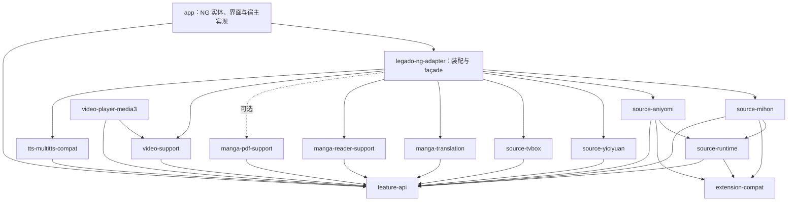

# Legado 功能模块化迁入 Legado NG 方案

编写日期：2026-11-09。本文是实施设计；代码实施与验证进度见 [迁移实施记录](FEATURE_MIGRATION_STATUS.md)，不得将本文拟定接口或批次视为已全部完成。TTS 已按最新要求收敛为“导入 MultiTTS 在线音色并生成 NG SCRIPT 引擎”；实测与限制见 [可行性审计](audits/MULTITTS_ONLINE_VOICE_FEASIBILITY.md)。漫画观看、预加载、缓存、翻译调度及 PDF 已逐项对照两边代码，完整清单见 [漫画迁移审计](audits/MANGA_READER_PRELOAD_MIGRATION_AUDIT.md)，实现位置与 PDF P01–P12 验证边界见 [漫画实施矩阵](audits/MANGA_FEATURE_IMPLEMENTATION_MATRIX.md)。

## 1. 范围与代码基线

源项目为 `D:\project\legado`，检查时分支为 `dev_text_v`，HEAD 为 `339e9af`；目标为 `D:\project\legado_NG`，当前工作分支为 `codex/migrate-legado-features`，HEAD 为 `7b6087410`。后续实施前应重新记录两边提交与工作区差异。

本次迁移范围：

1. 仅导入 MultiTTS 在线音色，按 XFPEIYIN、HUOSHAN、DIRECT_HTTP 三类适配生成 NG 现有 SCRIPT 引擎。复用当前引擎管理、多角色识别/绑定、自动选音、队列和播放；不引入 LegadoTts、外部 MultiTTS、系统 TTS 服务或私有离线运行库。讯飞已有抽样实测，另外两类按相同结构设计并分别验收；以第 4 节为准。
2. 漫画 OCR、文本翻译、擦字回填、队列、缓存与阅读入口。
3. 漫画观看辅助：跨章翻页、双页组合、稳定进度、章节正文/原图预取、视口文件/尺寸预取、缓存清理及图片展示；PDF 的分档渲染/预加载单独作为可选模块交付。
4. 视频：剧集、线路、清晰度、播放请求、播放器能力及源项目的视频增强能力。
5. Mihon/Tachiyomi 漫画扩展。
6. Aniyomi 视频扩展，作为视频源适配的一部分明确拆出。
7. 异次元源导入及执行兼容。
8. TVBox 配置、CMS、JAR Spider、JS Spider、解析嗅探与本地代理。

应用内 AI 多角色朗读、人物分析与分镜等，仅核对与上述 TTS 接口的衔接；不在本轮直接覆盖 NG 已有的整套实现。如果需要迁移旧项目这部分独有行为，应另立差异清单。

目标不是让模块彼此完全没有共享依赖，而是让共享能力有明确所有者，各功能不依赖其他功能内部实现，且不反向引用主应用。

### 1.1 已确认的目标项目基础

| 项目 | 当前代码事实 | 迁移约束 |
| --- | --- | --- |
| Android | `app/build.gradle` 使用 Java 17，minSdk 21，启用 Compose 和 ViewBinding | 新模块跟随目标项目工具链；新增依赖不能悄悄提高全应用最低版本 |
| 漫画 | 已有 `MangaReaderScreen`、`MangaImages`、`MangaPagedImages`、`MangaReaderState` 等 Compose 实现 | 按行为补齐，不整体覆盖阅读器 |
| 视频 | 已有 `ui/video/VideoPlayerActivity`、`VideoPlayerScreen`、`model/VideoPlay`、播放服务 | 通过播放适配桥衔接，避免同时维护两套进度与生命周期 |
| TTS | `TtsEngineType` 当前为 `SYSTEM`、`SCRIPT`；已有 `TtsEngineStore`、音色与运行时数据表 | MultiTTS 备份须转换为可执行 SCRIPT，不能直接导入 YAML 后便认定可发声 |
| 数据库 | `AppDatabase` 当前 version 为 120 | 沿 NG 的 schema 与迁移链演进，不套用源项目数据库版本 |
| JS | 已有 `modules/quickjs-sandbox`，包含 QuickJS/V8 相关桥接 | 与源项目 `quickjs-android-native` 不是相同模块，需适配验证 |
| 视觉 | 已有 NG 设计系统与 `verifyNgDesignSystem` | 新页面使用 NG 主题和组件，不引入旧主题体系 |

漫画、视频和扩展部分为本地代码分析；TTS 另做了实际备份解析、脚本请求检查和讯飞在线音频抽样验证。未完成 Android 应用内集成、设备播放或全目录可用性验证，见审计报告。

## 2. 总体架构与目录

```text
lib/
├─ settings.gradle                 被根 settings.gradle 引用的模块声明脚本
├─ README.md                       模块导航、边界与构建方式
├─ feature-api/                    中立 DTO、宿主端口、能力与错误模型
├─ extension-compat/               第三方扩展共享 API/ABI 兼容面
├─ source-runtime/                 扩展仓库、信任、安装、加载与公共网络桥
├─ source-mihon/                    漫画扩展业务与图片请求
├─ source-aniyomi/                  视频扩展业务与播放资源解析
├─ source-yiciyuan/                异次元转换、规则策略和解密兼容
├─ source-tvbox/                   TVBox 配置、CMS/JAR/JS、嗅探和代理编排
├─ manga-translation/              OCR、翻译、擦字、回填、队列与缓存
├─ manga-reader-support/           翻页状态机、双页与预加载策略
├─ manga-pdf-support/              可选：PDF 优先级渲染、预览/高清、缓存与释放
├─ video-support/                  剧集、线路、清晰度与播放会话
├─ video-player-media3/            从源项目抽取的播放器与画面增强，可选接入
├─ tts-multitts-compat/            安全备份解析、中立音色 DTO、提供方脚本模板与诊断
└─ legado-ng-adapter/              功能装配、公开 façade、协议转换与可选桥

app/src/main/java/io/legado/app/integration/
├─ FeatureBootstrap.kt            创建宿主实现并启动模块
├─ source/                        NG Book/BookSource/BookChapter 映射与路由
├─ rule/                          NG 规则/JS/解密宿主实现
├─ image/                         NG 图片下载、解密与 Glide 接入
├─ manga/                         NG 阅读器状态、动作及翻译状态适配
├─ video/                         NG 播放器/进度/导航适配
├─ tts/                           中立导入结果转 NG SCRIPT 配置及导入预览
└─ platform/                      配置、日志、文件、AI、主题与平台能力
```

`extension-compat`、`video-player-media3` 是对前述结构的补充：前者防止 Mihon 与 Aniyomi 因共享 API 互相依赖；后者容纳旧播放器与增强实现，使其不挤入只负责数据和会话的 `video-support`。

漫画代码核对另补充 `manga-pdf-support`：源 PDF 已有独立渲染/缓存调度，NG 尚无同等实现。其 Android 资源放在可选模块，普通漫画与纯 JVM 阅读策略不依赖它，详见第 6 节。

初期可先创建正在实施的模块，不要求一次建立全部空壳。每个正式模块需要自己的构建文件、README、测试目录；Android Library 另有 Manifest、资源和必要的 `consumer-rules.pro`。

### 2.4 所有迁移功能的隔离规则

本规则适用于本方案全部迁移项，不限于漫画：异次元、TVBox、Mihon/Aniyomi、视频增强、漫画阅读/翻译/PDF 和 MultiTTS。可迁移的业务逻辑、状态机、请求策略、缓存策略、格式转换、提供方模板及功能测试归属独立 `lib/<feature>` 模块；不把这些实现散落进 NG 现有 `model`、`help`、`ui`、`service` 核心目录。

NG 主工程只承担四类薄接入：模块装配与生命周期、NG 实体/数据库/配置到中立 DTO 的映射、最小 UI 导航/动作 hook、平台能力实现（网络、存储、AI、Glide/播放器）。新增逻辑优先放 `app/integration/<feature>`；确实需要触碰现有 NG 文件时，只增加可定位的委托调用或扩展点，不在上游文件内实现完整策略，不顺手重排/重构周围代码。对同一 NG 文件的 hook 进行归并，禁止不同迁移项重复插入平行入口。

优先使用 feature-api 端口，不让模块依赖 NG 具体类；不得为省适配而复制 NG 实体、直接引用 `app` 源目录、建立模块到 `:app` 的编译依赖，或让 `app/integration` 反向变成业务实现仓库。Room/核心模型修改仅在端口映射无法满足既有数据语义时采用，并单独提交 schema/迁移与回滚说明。每项实现都要能独立编译/测试模块；集成 hook 要有明确默认行为、最小差异和针对普通 NG 路径的回归验证。

目标是让后续同步 NG 上游时，功能实现主要留在独立模块，冲突集中在少量 hook 与端口映射；不承诺零冲突，但不得以“模块化”为由把大量迁移实现写回上游文件。

### 2.1 依赖方向

下图箭头表示编译依赖。`feature-api` 是底层接口，`app` 是最终装配方。



`video-player-media3` 由适配层按构建配置选择性依赖，并注入给视频会话。TVBox 不直接依赖播放器，Aniyomi 也不直接调用 TVBox。

### 2.2 必须避免的循环依赖

如果 `app` 引入 `legado-ng-adapter`，该 Library 就不能导入 `app` 的 `Book`、`BookSource`、`appDb`、`AppConfig`、`ReadManga` 或 `app.R`。把同包名实体复制进 Library 同样不可行，会造成重复类和数据所有权混乱。

因此适配分两层：

- `lib/legado-ng-adapter`：只处理模块接口、能力注册、通用协议及装配逻辑。
- `app/integration`：实现需要 NG 内部类型的端口，完成 NG 实体与中立 DTO 的映射。

推荐使用独立包名前缀，如 `io.legado.features.*`。只有第三方插件按全限定类名查找的兼容类保留原包名，并保证 APK 中只有一份。

### 2.3 模块类型与依赖范围

| 模块 | 初始建议 | 依赖边界 |
| --- | --- | --- |
| feature-api | Kotlin/JVM，可使用协程 | 不出现 Android View、Bitmap、Room、Compose、NG 实体 |
| extension-compat | Android Library | 保留插件需要的 ABI；不公开 NG 类型 |
| source-runtime | Android Library | Android 安装/类加载与共享宿主能力 |
| source-mihon / source-aniyomi | Android Library | 共享 runtime，输出中立结果 |
| source-yiciyuan | Android Library 起步 | Android Base64、Rhino 等依赖抽清后可再细分纯 JVM 部分 |
| source-tvbox | Android Library | JAR、JS、WebView、代理均封装于模块或注入端口 |
| manga-translation | Android Library | Bitmap、ML Kit、Canvas 在模块内部 |
| manga-reader-support / video-support | 优先 Kotlin/JVM | 布局策略和会话不依赖 Compose、GSY、ExoPlayer |
| manga-pdf-support | 可选 Android Library | PdfRenderer、文档句柄、分档渲染和缓存，不依赖 app 实体或其他漫画业务模块 |
| video-player-media3 | Android Library | Media3、效果资源和渲染宿主 |
| tts-multitts-compat | 优先 Kotlin/JVM | 备份解析、身份/参数/风格映射与脚本模板输出；不含播放器、NG 实体、系统服务或离线库 |
| legado-ng-adapter | Android Library | Android 装配，不依赖 app |

只在公共签名确实暴露第三方类型时使用 `api`；其余使用 `implementation`。禁止 `compileOnly(app)`、跨目录引用 app 源码、复制 app 数据类等绕过依赖边界的做法。

## 3. 公共契约与宿主能力

以下名称是拟定接口，不代表当前仓库已有实现。先按领域在 `feature-api` 内分包，避免变成一个包含所有对象的全局工具箱。

| 契约 | 关键内容 | 实现或使用方 |
| --- | --- | --- |
| SourceKey | provider、contentKind、nativeId、必要的配置命名空间 | 各源模块与 NG 映射 |
| SourceDescriptor | 稳定 ID、名称、漫画/视频类型、能力、启停状态 | 源模块输出，NG 展示与入库 |
| CatalogItem / ChapterDescriptor | 中立作品与章节信息，保留源原始 ID | 源模块输出，NG 映射 |
| SourceProvider | 搜索、发现、详情、目录、正文/资源解析 | Mihon、Aniyomi、TVBox 实现 |
| FilterSession | 按源与请求会话隔离的筛选实例 | 每次请求明确传递 |
| ContentResult | 图片列表、视频资源、文本/HTML 等显式类型 | 适配层转换为 NG 当前格式 |
| SourceImportAdapter | 识别、预览、转换结果及诊断 | 异次元实现 |
| RuleCompatibilityPolicy | 规则预处理、结果归一化、URL/正文兼容策略 | 异次元实现，NG 规则桥调用 |
| RuleExecutionPort | 执行规则与 JS、提供受源作用域约束的上下文 | app/integration/rule 实现 |
| SourceSessionPort / HttpTransport | 源作用域网络、Cookie、超时、取消和流式响应 | NG 网络适配或 runtime 平台实现 |
| ImageResourceResolver | 对资源引用返回处理后原图文件/流及版本 | 普通图片由 NG 实现，插件由模块实现 |
| TranslationEngine | 请求、优先级、状态观察、取消、缓存清理 | manga-translation 实现 |
| VideoResolveResult / PlaybackRequest | 线路、清晰度、请求头、字幕/代理引用、有效期 | 视频源模块输出 |
| VideoPlayerPort / PlaybackProgressPort | prepare/play/pause/seek、事件与进度持久化 | 播放器模块或 NG 桥实现 |
| MultiTtsImportResult / ImportedVoice / ScriptEngineDraft | 解析结果、原始音色参数、风格、脚本与诊断；不定义新的合成执行器 | tts-multitts-compat 输出，app/integration 转 NG 类型 |
| ConfigPort / FileStorePort / LogPort | 按模块命名空间访问配置、目录和诊断 | NG 或独立模块存储 |
| AiTextTranslationPort | 必要文本/结构化翻译请求及能力信息 | NG 现有 AI 服务适配 |

### 3.1 身份、错误与调用约定

- 源身份不能只用数字 ID：源项目漫画和视频 Mapper 都使用 `tachiyomi://`，应以内容类型和 provider 一起路由，避免错误分发；旧 URL 由迁移桥兼容解码。
- 原始作品/章节/图片 ID 与展示 URL 分开保存；不要仅以名称去重。
- 各请求带源身份、配置版本、会话/请求版本及明确的取消归属；章节切换不依赖全局 `ReadManga` 查找当前对象。
- 未命中某功能使用显式 `NotHandled`，不能把执行失败当成未命中再回退到普通书源。
- 错误至少区分网络、认证、扩展缺失、运行时不支持、源规则错误、解析为空；协程取消继续向上传递。
- 查询响应、图片、音频优先使用流或文件句柄，调用者负责关闭；不得把大型图片或音频全部放进公共 DTO 的字符串字段。
- 共享下载或翻译任务应区分“取消订阅者”和“取消底层任务”，仍有前台订阅时不因预加载取消而终止。

### 3.2 初始化与生命周期

`FeatureBootstrap` 提供 NG 宿主端口后调用 `FeatureAssembly.create(...)`，得到类型明确的功能句柄。可选功能在未安装时返回不可用能力，不能在类初始化时崩溃。

初始化顺序：配置/目录/网络端口 → runtime 与后端注册 → 源提供方注册 → 图片与规则桥注册 → 页面按需创建会话。重任务延迟执行。关闭会话释放订阅与任务；释放应用能力时停止代理、JS 实例、模型和播放器。进程被重建时仍可由 Application 重建服务需要的配置与后端，不能依赖用户先打开设置页。

## 4. MultiTTS 在线音色导入与现有 NG 引擎适配

### 4.1 最新边界与可行性结论

只引入 MultiTTS 在线音色的备份解析和提供方适配，不迁入 LegadoTts，不安装或调用外部 MultiTTS，不增加 NATIVE 类型或另一套合成/播放框架。原 SYSTEM/SCRIPT 分类、既有引擎配置和多角色业务保持当前语义。

用户提供的 `C:\Users\Administrator\Downloads\xfpeiyin(1).zip` 为讯飞配音目录。2026-11-09 审计已解析 189 条记录，并用 NG 仓库实际使用的 HtmlUnit JS JAR 执行签名/请求原型；六个真实请求组合返回有效非静音 WAV，覆盖默认发音人、风格及 16/24 kHz。该证据证明这些抽样音色具备脱离两个外部实现独立在线合成的基础，不代表所有 189 条已逐一验证，更不代表已接入 Android 应用。详见 [审计报告](audits/MULTITTS_ONLINE_VOICE_FEASIBILITY.md)。

备份仅含音色描述、参数和头像，不包含通用在线合成实现。每家提供方需要各自可执行的协议模板；“type=1 / 在线”不能替代协议支持证明。三类适配均采用“解析备份 → 提供方模板 → NG SCRIPT → 现有目录/多角色/播放”的方案。当前先以已抽样验证的 xfpeiyin 固定样板，再实现源项目另外两类 HUOSHAN、DIRECT_HTTP；未识别提供方明确列为不支持，不通过本地转发器伪装独立运行。

| 三类适配 | 请求策略 | 当前证据 | 交付边界 |
| --- | --- | --- | --- |
| XFPEIYIN / 讯飞配音 | 文本签名、解密、返回 synth 音频请求 | 实际备份 189 条解析、204 个离线组合、6 个真实音频组合 | 按 4.5.1 接入并完成应用内验证，未全量验证所有音色 |
| HUOSHAN / 火山翻译语音 | POST JSON，校验业务状态，提取 audio.data Base64 | 已核对源项目实现和 NG JSON/Base64 提取路径；未取得该类实际备份并联网验证 | 按 4.5.2 独立实现，真实样本通过后再标为已验证 |
| DIRECT_HTTP / 通用 HTTP 模板 | 已支持占位符替换后，由 NG 请求音频 | 已核对源项目模板语法、字段语义和 NG 请求路径；无具体 URL/音色样本验证 | 按 4.5.3 实现受限模板适配；逐模板/服务记录支持范围 |

这里“另外两类”指源代码 `OnlineTtsBackendType` 中除 XFPEIYIN 外的 HUOSHAN 和 DIRECT_HTTP；DIRECT_HTTP 是一类请求模板，不是一家固定的服务商。采用同一架构不意味着共用讯飞签名、vid 规则、参数换算或音频格式。

### 4.2 lib 归属与可参考的源代码

`lib/tts-multitts-compat` 按 backup、catalog、identity、parameters、templates、diagnostics 分包，输出中立 DTO 与真正执行在线请求的脚本。不依赖 `:app`、NG Room、角色模型、Media3 或 Android TextToSpeech。模板由模块以字符串等可打包形式输出；宿主只转换为 NG 配置，不把提供方实现散落进朗读服务。`templates/xfpeiyin`、`templates/huoshan`、`templates/directhttp` 各自持有识别、请求、参数和响应规范，共用解析与目录 DTO，不互相依赖。

| 源项目代码 | 本次用途与取舍 |
| --- | --- |
| `model/readAloud/MultiTtsEngineStore.kt` | 参考 ZIP/YAML 字段和 `param`/`extendUI` 解析；不照搬行解析和按姓名/性别去重 |
| `model/readAloud/OnlineTtsBackendCatalog.kt` | 参考提供方识别，未知提供方保留诊断，不直接列为可发声 |
| `service/OnlineTtsBackendRegistry.kt` | 分别参考讯飞签名、火山 JSON/Base64、通用 HTTP 占位符三条路径，生成各自 NG SCRIPT；不复制该单例、线程池或预加载缓存 |
| `LegadoTtsEngineService.kt`、`LegadoTtsSynthesizer.kt`、Sherpa、外部 MultiTTS 桥 | 不在本次交付内 |

拟定模块接口为 `parseBackup(InputStream)`、`buildScriptEngineDraft(...)`，返回目录、可支持/不支持条目及原因。`app/integration/tts/NgMultiTtsImportAdapter` 转换为 `TtsEngineSetting`、`TtsVoice` 和已有导入冲突操作。模块无需知道 NG 数据库实体。

### 4.3 从备份到现有选音的步骤

1. 从现有引擎设置增加“导入 MultiTTS 在线音色”的入口，由宿主打开文件并提供输入流。
2. 模块读取 ZIP 中 `config.yaml`、`engines.yaml` 等已支持入口。禁用任意 YAML 类实例化；只识别已知标签，限制大小/别名/嵌套，拒绝重复关键字段，头像提取另做路径和体积校验。
3. 保留 engine code、speaker code、名称、语言、性别、采样率说明、speed/pitch/volume、param、extendUI 及原始元数据。多行块和 YAML 折行字符串均需正确解析。
4. 按提供方解释音色参数：讯飞的数字 `param` 映射到真实 vid；火山使用已解析的 speaker 值，不套讯飞的纯数字限制；DIRECT_HTTP 的 `voiceCode` 沿源模板语义使用原始 speaker.code。`@style` 引用到对应 `extendUI.code`，`value` 为默认值，已支持的 `candidate` 转为 NG `extra.styles`。当前讯飞样本 183 条数字、6 条引用、15 个风格候选，无未解析编号；另外两类不能直接套用这些统计。
5. 显示导入预览、提供方支持状态、同名/同 vid 提示和重复导入操作；不立即更改当前朗读引擎或已有绑定。
6. 按提供方及独立配置命名空间生成实际 SCRIPT 引擎；同一 ZIP 混含三类时，预览分别列出支持状态，不合并成一种请求协议。使用现有 `TtsEngineStore.importEngineText()` 导入配置；目录通过现有 `upsertVoiceList()`/`ensureVoiceCatalog()` 流程投影入库。注意 `upsertVoiceList()` 内部是整目录替换，必须先完成合并语义，不能当逐条增量 API 使用。
7. 将目录同时包含在可导出的配置/脚本中，让本地 `voices()` 返回同一目录，保证强制刷新、清缓存、导出恢复后不会失去音色。运行时 Room 投影不是唯一备份。
8. 用户在现有多角色引擎选择中选择这个新增引擎，继续使用现有手动绑定或自动/AI 选音。

同名条目不直接删除；本包有 31 组重复名称，以及 22 组重复默认 vid。189 条描述不等于 189 种不同音质。保留不同参数/风格和历史身份；完全等价项可标记别名或借用现有禁用音色机制减少自动候选重复，不按名称强行合并，不改现有选角算法。

### 4.4 身份、目录与现有多角色的关系

引擎 ID 使用固定的导入提供方/目录命名空间；音色 ID 以 provider + speaker code 构成，如 `xfpeiyin:tianming`。文件名、姓名、ZIP 内容哈希不作为音色 ID。默认 vid 和风格 vid 放入 `extra`，不能拿 `tianming` 字符串直接请求讯飞。备份内容版本用于缓存更新，不能随版本变化重建 engineId/voiceId。

| MultiTTS 字段 | NG 映射 |
| --- | --- |
| `code` | 稳定 `TtsVoice.id` 与 extra 原始 code |
| `name`、`locale` | name、language |
| `gender=1 / 0` | male / female，不能直接写成数字字符串给当前性别匹配器 |
| `param` / `extendUI.value` | extra 的提供方参数；讯飞为 vid、火山为 speaker；DIRECT_HTTP 原始 code 单独保留 |
| `extendUI.candidate` | `extra.styles`：id、name、value；合成读取 `voice.style_value` |
| speed、pitch、volume、sampleRate | extra 原始参数；只应用协议已支持的项，sampleRate 不强制伪装成实际输出格式 |
| 原始字段、别名、重复关系 | extra 或独立原始导入元数据，导出/恢复必须保留 |

`BookTtsCastingCoordinator.currentMultiRoleEngine()` 当前只接受启用的 SCRIPT；候选来自该引擎的 `enabledVoices()`。`ReadAloudTtsRouter.isBookBindingCompatible()` 限制非旁白绑定须匹配当前 `multiRoleTtsEngineId`。本包一个提供方放在一个 SCRIPT 中即可符合现有约束，无需改人物识别、角色分配或回退算法。

手动角色选音和自动/AI 选音共用该目录，仍存现有 `BookCharacterTtsBinding` 的 engineId/voiceId 与 emotionStyleMapJson；最终 styleId 由现有路由产出，不新增绑定字段。旁白沿用现有单独选择语义。不能声称每个角色都能任意跨独立提供方引擎混选；后续若确需多提供方同时用于对白，可另做一个聚合 SCRIPT，在内部按 `voice.extra.provider` 分发，而不是重构当前角色系统。

### 4.5 在线脚本、参数与缓存

#### 4.5.1 XFPEIYIN：讯飞配音

xfpeiyin 的脚本 `synthesize()` 根据文本计算 MD5，以 AES/ECB/PKCS5Padding 加密请求，调用 works_synth_sign，解密取得时间戳和签名，返回带真实 vid 的 synth GET 请求对象。最后的音频 HTTP 请求仍由 NG `TtsScriptEngineClient` 执行。不要返回 `localhost:8774/forward`；仓库现有 `multitts_forwarder.js` 依赖外部服务，不满足本次要求。

审计原型以 JCA 显式指定 `SecretKeySpec(..., "AES")`，不依赖额外 BC 提供器；最终脚本需在 NG 实际包装/类策略下核验。模板只使用既有可访问的加密与网络能力，不放宽脚本类策略。公开网页协议常量不等于用户凭据；本次抽样无需登录 Cookie、账号密钥或伪造转发 IP，但不能保证未来协议不变化。

NG 合成参数以 50 为中值。速度按 `round(params.speed * speaker.speed)` 限制到 0..100，再转为讯飞 `speed=值*4-200`；音量按对应倍数转为 `volume=round(值*0.4-20)`。这是对旧实现中“朗读比例 100 为中值”的转换，不能把 NG 的 50 原样送入旧比例公式。NG 本地播放器倍速继续走现有 `TtsSpeedPolicy`，不与合成速度重复叠算。

脚本头声明已实现的 `synthesis_speed`、`synthesis_volume`、`style_tags`。未实现音调、连续情绪等能力不声明；不能仅在 JSON capabilities 字段填写，因为当前配置规范化会从脚本头重新解析能力。备份 pitch 保留，当前样本均为 1.0；不宣称讯飞 synth 已支持任意 pitch。

**音频类型实际差异：**六个样本的 HTTP Content-Type 均为 audio/mpeg，但内容是 PCM WAV。NG `requireAudioStream()` 会按配置正则校验头；本模板显式使用 `audio/(mpeg|wav|x-wav)`，并在 Android 验证实际字节识别和播放，不能沿用默认的仅 audio/x-wav 配置。

现有缓存键含 script 哈希、optionValues、voiceId/styleId、参数、上下文和文本，未直接包含 voice.extra。目录/参数更新时，应把规范目录哈希写入生成脚本的版本标记或固定配置版本项，让缓存键跟随变化；不能只改 Room extra 而复用旧音频。风格必须进入 styleId 和最终 vid，避免“选了风格但音色未变”。

#### 4.5.2 HUOSHAN：火山翻译在线语音

按源项目 `OnlineTtsBackendCatalog` 的 `engine.code=huoshan` 识别。此处适配的是源代码已有的火山翻译网页语音协议，不泛称支持所有火山/豆包商业 TTS 接口。备份 URL 非空时保留其明确配置，否则以源实现中的 `https://translate.volcengine.com/web/tts/v1` 为初始模板地址；该地址来自本地代码，当前在线有效性尚未实测。

生成独立 SCRIPT，其 `synthesize()` 返回 NG 原生请求对象，基本结构如下。示意变量由模板/目录生成，不是要求用户填写内部字段。

```javascript
return {
    url: endpoint,
    method: "POST",
    headers: {"Accept": "application/json"},
    requestContentType: "application/json",
    body: {language: "zh", speaker: resolvedSpeaker, text: text},
    responseType: "json",
    audioExtract: "audio.data",
    audioEncoding: "base64",
    audioContentType: "audio/wav"
};
```

`resolvedSpeaker` 默认取按 `param`/`extendUI` 规则解析后的值，必要时回退到原始 code；只有样本证明对应风格可直接作为 speaker 时才使用 `voice.style_value`。speaker 不强制为数字。源实现固定 `language=zh`，本次先保留这一已知请求语义；locale 仍进目录，不仅凭 locale 声称接口支持任意语言。

源实现还检查 `base_resp.status_code`，非零时展示 `status_message`。NG 当前 `toAudioResponse()` 支持 Base64 提取，但没有该业务状态检查，不能把“找不到 audio.data”冒充完整错误适配。计划在中立 ScriptEngineDraft 中携带可选响应校验描述，由宿主映射为待新增的请求字段（如 `responseValidation`）；字段缺省维持已有脚本行为。只在本模板显式启用时，于 JSON 音频提取前检查“状态字段存在且非零”为失败，错误消息取约定字段；缺失音频继续使用既有错误。该字段尚未实现，须覆盖成功、业务失败仍带 audio、缺失状态、非法 JSON、空/非法 Base64 和取消回归，不扩展为任意表达式执行。

除这一受限校验接入外，POST、超时、取消和 Base64 解码继续由 `TtsScriptEngineClient` / AnalyzeUrl 执行，不在模块再开网络线程或重复解码/播放。源代码注释描述 WAV，最终 `audioContentType` 以真实样本字节核验后确定；Base64 解码响应需要一个具体 MIME，不照搬讯飞用于 HTTP 头校验的正则。

源火山请求没有 speed、volume、pitch 参数，本模板初版不声明 `synthesis_speed`、`synthesis_volume`、`synthesis_pitch` 或任意情绪控制。保留备份参数与风格元数据，不假装它们都能作用于服务端；现有 NG 本地音色播放参数与倍速功能继续复用，也不自动叠加备份倍数。

身份使用 `huoshan:<speakerCode>` 等稳定命名空间，目录、手动/自动角色绑定、导出恢复、禁用状态和缓存版本规则与讯飞共用。验收需提供实际火山备份或明确 speaker 样本，至少两个不同 speaker 的有效音频、真实返回格式、业务失败和多角色交替播放；这些尚未完成。

#### 4.5.3 DIRECT_HTTP：通用 HTTP 在线模板

这是源项目对“URL 非空，且 type 为空/http/online/web”的后备识别，优先级低于明确的 xfpeiyin/huoshan。迁入时保留这项识别依据，但 URL 只能证明有请求地址，不能证明服务可用、音色在线或无需外部软件。依赖 localhost、127.0.0.1、::1 或外部 MultiTTS 进程的模板不满足本次独立合成要求，应提示原因而非包装为已支持；用户自有远程 HTTP 服务按其实际依赖说明。

模块将已支持模板编译为 SCRIPT 的请求构造函数。源实现为 GET 音频请求，初版也限定该格式，不宣称支持任意 MultiTTS JS、POST DSL 或自定义鉴权程序。

| 源模板占位符 | 迁入语义 |
| --- | --- |
| `{{voiceCode}}` | 原始 speaker.code 的 URL 编码；不擅自改成 param 或讯飞 vid |
| `{{speakText}}`、`{{java.encodeURI(speakText)}}`、`{{java.encodeURIComponent(speakText)}}` | 按旧实现统一将文本作 UTF-8 查询值编码，空格使用 %20；这些是受支持的固定语法，不执行其中的 Java/JS 代码 |
| `{{speakSpeed}}`、`{{speakPitch}}`、`{{speakVolume}}` | 提供方模板参数映射后的数值 |
| `{{2 - speakSpeed * 0.015}}` | 兼容原实现允许的空白变体，替换为相同算式结果 |
| `{{speakVolume * 4}}` | 兼容原实现允许的空白变体，替换为相同算式结果 |
| 其他占位符 / 替换后残留 `{{`、`}}` | 标为不支持并定位字段，不原样发请求或用通用 eval 猜测执行 |

保留原始模板文本与音色 code，转换时一次性编码查询值，避免 URL 编码两次。样例须覆盖中文、换行、空格、`&`、`+`、百分号及模板表达式，验证文本未截断、请求未被注入额外参数。

源实现的中值基线为 speed=30、pitch=50、volume=50，再乘 speaker 倍数。NG 参数统一以 50 为中值，计划映射为 `speed=clamp(round(30*(params.speed/50)*speaker.speed),1,100)`、`pitch=clamp(round(params.pitch*speaker.pitch),1,100)`、`volume=clamp(round(params.volume*speaker.volume),1,100)`；模板中的额外算式在该值基础上计算。这样保留旧默认行为并适配 NG 参数面板，不套讯飞的 -200..200 换算。源 volume 原本没有运行时输入，本次显式支持 NG volume 的变化需以对应模板样例验证。

只有模板实际使用且已验证的参数才在脚本头声明合成能力；模板未消费的参数仍保留元数据，不显示成已支持。初版 `voiceCode` 只用原始 code，不因发现 extendUI 就声称支持风格；存在额外语法时单独扩充受限适配并附样例。

最终返回 `{url: resolvedUrl, method: "GET", responseType: "audio", ...}`，仍由 NG 获取音频。响应 MIME、是否为原始 PCM、是否需要专用 JSON/Base64 适配均按该模板实测决定。不能因为一个 HTTP 模板成功便标记所有 DIRECT_HTTP 可用；未知响应结构或缺少必要鉴权时明确不支持。

DIRECT_HTTP 的稳定身份须包含原始 engine.code/配置命名空间，避免不同服务同名 speaker 互相覆盖，例如 `directhttp:<engineCode>:<speakerCode>`。更改 endpoint、请求模板或参数规则时更新脚本/配置版本以使缓存失效，保留稳定的 engineId/voiceId 与角色绑定；完全不同的服务通过“新增独立配置”产生新命名空间。

#### 4.5.4 三类共用与隔离边界

共用备份解析、原始字段保存、稳定 ID、目录生成、导入预览、禁用状态、导出恢复、缓存版本和 NG 接入桥；提供方识别、端点/请求、参数转换、风格含义、响应校验和 MIME 由各自模板持有。一个提供方适配失败不得改写其他引擎或已有角色绑定。

三类各自生成合法的 SCRIPT，均可作为现有多角色引擎被选择。现有对白仍一次使用一个 `multiRoleTtsEngineId`，导入三种引擎不会自动建立跨引擎候选池。若后续需要一段朗读中同时选三家音色，再按 4.4 的聚合 SCRIPT 扩展设计处理；本轮不改现有选角算法。

### 4.6 宿主接入点与取消缺口

```text
ZIP → lib/tts-multitts-compat → 中立目录 + 提供方脚本
    → app/integration/tts → NG SCRIPT 配置/现有目录
    → 现有多角色选音与绑定
    → ReadAloudTtsRouter → TtsScriptEngineClient
    → 对应协议（讯飞签名 / 火山 POST+Base64 / HTTP 模板）
    → 原有缓存、队列、Media3
```

| 位置 | 本次处理 |
| --- | --- |
| settings.gradle / app/build.gradle | 单一模块声明/依赖；不修改当前既有环境调整 |
| 现有引擎设置/文件导入入口 | 增加 ZIP 入口、解析预览和错误诊断，继续使用现有选音 UI |
| app/integration/tts | 中立 DTO 转换、稳定 ID、重复导入/目录合并、生成脚本版本 |
| TtsEngineStore | 优先复用现有导入与目录 API；不新建一套配置存储 |
| ReadAloud / HttpReadAloudService / Preview | 维持已有 SCRIPT 分发和音频获取链，无 LegadoTts façade |
| Router / CastingCoordinator / 角色表 | 不重写现有识别、选角、绑定和回退算法 |
| TtsScriptEngineClient 的 JS 求值边界 | 必须验证并补足签名阶段的取消上下文传播，见下文 |
| TtsScriptEngineClient 的 JSON 响应边界 | 火山模板按需加入可选、受限业务状态检查；旧脚本缺省行为不变，校验规则由模块生成 |

代码审计发现：`executeSynthesis()` 收到 coroutineContext，最终 `executeRequest()` 会传给 AnalyzeUrl；但 `prepareSynthesisRequest()` → `callEngineFunction()` → `BaseSource.evalJS()` 没有显式传入同一个上下文。`JsExtensions.ajax()` 读取 Rhino 上下文，否则为 EmptyCoroutineContext。因此不能保证停止朗读能及时取消脚本内签名请求。15 秒超时只是上限，不等于取消语义正确。

实施时在 TTS 局部求值适配中贯通当前 Job，复用已有 `RhinoScriptEngine.eval(js, scope, coroutineContext)`；保留每次求值绑定、共享库作用域和既有类策略。具体接法先写针对性取消回归，避免只加一个未使用的 context 参数。若必须触及 BaseSource，只增加默认保持原行为的显式上下文入口并单独审查。取消在签名成功前后均应向上传递，不转成普通错误或重试，不在停止后继续排入音频队列。

该最小基础修补不改变多角色算法，但意味着“所有代码都放 lib、app 一行不动”无法承诺。提供方和导入逻辑仍在 lib，宿主只保留少量可追踪接入点。

### 4.7 实施顺序与验收门槛

1. 先固定当前真实备份为开发者本地样本，建立安全解析、身份/风格/原始参数和导出往返验证；不得把用户原始 ZIP、头像或生成音频提交进仓库。
2. 创建独立模块和 xfpeiyin 模板，转换为一个真正的 NG SCRIPT；先在 NG 求值边界验证 voices、synthesize、额外参数和 Content-Type，再增加导入入口。火山和通用 HTTP 随后共用该入口，分别增加自身模板与实际备份样例，不另建两套导入/角色业务。
3. 修补并测试签名/音频请求取消、超时、错误回传；确认缓存随目录变化失效，重复导入不打断已有绑定。
4. 在当前多角色流程手动绑定两个不同 vid，再执行自动/AI 选音。验证目录、角色片段路由、实际请求 vid、风格切换、交替发声、暂停/恢复和重启后绑定。
5. 覆盖目录刷新、导出恢复、旧引擎回归、正常与失败回退。独立脚本联网成功不等于这些 Android 流程已验证。
6. 189 条记录的编号已解析，不默认代表全部在线可用；全量检查使用用户主动触发、有限并发和明确结果状态，不在每次导入时自动批量请求。
7. 火山单独验证业务状态检查、audio.data Base64、实际格式、不同 speaker 和不支持的参数；DIRECT_HTTP 按具体服务验证模板编码、替换后无残留、默认及边界参数、响应类型和外部依赖，不套用讯飞实测结论。
8. 三类分别覆盖多角色手动/自动选音和稳定身份恢复，混合备份预览显示各自结果；一类失败不影响其余已导入引擎。没有实际备份或在线样本的适配保留“待验证”状态。

### 4.8 TTS 分批交付清单

| 子批次 | 交付内容 | 完成条件 |
| --- | --- | --- |
| T1.0 共用基础 | tts-multitts-compat、导入预览、目录/身份/版本、宿主桥 | 无 app 反向依赖；重复导入/刷新/导出恢复；现有角色及引擎回归 |
| T1.1 讯飞 | XFPEIYIN 脚本、签名取消、MIME 兼容 | 已有样本接入 NG，风格与角色实际交替播放通过；不以桌面样本代替 Android 验收 |
| T1.2 火山 | HUOSHAN 脚本、可选业务状态检查、Base64 响应 | 真实备份/speaker 样本、有效音频/错误/取消及现有多角色回归 |
| T1.3 通用 HTTP | DIRECT_HTTP 受限模板、参数/编码和服务身份 | 每个声明支持的服务有实际模板/音色样本和闭环结果；外部进程依赖明确 |

三类遵循同一接入方案，完成状态分别记录；各自通过验收后才标记对应适配已完成。

目前完成的是可行性审计和本方案更新，尚未实施生产模块/导入入口或改动现有 TTS 发声链。

## 5. 漫画自动翻译

### 5.1 源实现与依赖

源目录 `app/src/main/java/io/legado/app/model/manga/translation/` 包含：

- `MangaTranslationManager.kt`：识别、翻译与绘制编排；迁移流程时将源 AI 调用替换为 NG 现有 AI 服务适配，不搬入源项目 AI 客户端/提供方。
- `MangaTranslationConfig.kt`：只迁移翻译语言、OCR、公共翻译提供方及预加载等必要偏好；AI 模型、提供方、凭据和服务配置继续由 NG 现有 AI 设置管理。
- `MangaPublicTranslator.kt`：公共翻译提供方。
- `MangaTranslationQueue.kt`：前后台优先级、并发和公平调度。
- `MangaTranslationInput.kt`、`MangaTranslationPageCache.kt`：输入快照与页缓存。
- `MangaTranslationFallback.kt`、`MangaTranslationBackground.kt`、`MangaTextEraser.kt`：回退、背景和文字区域处理。

另有 `help/glide/MangaTranslationLoader.kt`、`model/BookCover.kt`、`res/values/manga_translation_settings.xml`、`ui/book/manga/config/MangaTranslationSettingsDialog.kt` 及阅读菜单接入。源 Gradle 声明 ML Kit Latin/Japanese/Korean text recognition；依赖应归入翻译模块。

### 5.2 模块内拆分

`manga-translation` 内按职责拆为 input、ocr、public-translation、render、queue、cache、config。外部仅暴露翻译会话与状态；不把 `MangaPage`、`Bitmap` 或 Glide RequestBuilder 作为中立 API。AI 请求不在此模块实现 provider/client、模型选择器、密钥存储或独立配置；通过 app 层适配器调用 NG 已有 AI 服务，使用其现有模型、凭据、限流和全局设置。

| 子功能 | 接入方式 |
| --- | --- |
| OCR | 模块内部持有 ML Kit recognizer，按语言/识别能力选择，释放会话时关闭资源 |
| Google/Bing 等公共提供方 | 迁移已有实现和明确的选择/回退策略 |
| DeepL/Baidu/LibreTranslate | 保留当前配置字段、鉴权与端点约束，凭据通过配置接口获取 |
| AI 文本/视觉推理 | 通过 `AiTextTranslationPort` 调用 NG 现有 AI 服务；模型、provider、凭据、网络客户端和全局限流全部复用现有实现，不迁移源 AI 或建立第二套设置 |
| 绘制 | 模块内部处理文字框、擦除、换行与回填，产出文件和版本信息 |
| 缓存 | 输入内容/身份、源会话版本、语言、提供方与配置版本、算法和渲染版本共同决定身份 |

显式选定 Google/Bing/DeepL/Baidu/LibreTranslate 等公共翻译提供方时保持其选择语义；自动模式才按漫画翻译偏好回退。AI 路由与模型选择遵循 NG 现有 AI 服务配置，不复制源项目 AI provider 选择、凭据或 fallback。超时、NG 服务限流/配置错误、空 OCR 与用户取消分别映射为翻译状态，不把失败结果长期缓存为成功图片。

### 5.3 图片链路与 NG 接入

```text
NG 阅读会话生成 ImageResourceRef
    → ImageResourceResolver
      ├─ 普通源：NG ImageProvider、请求头、Cookie、解密、缓存
      └─ 插件源：Mihon 扩展图片请求与响应处理
    → 已处理原图文件/流
    → OCR → 文本翻译 → 擦字/回填 → 译图缓存
    → TranslationState → NG Compose 图片组件
```

采用“先显示原图，再按状态替换译图”的目标体验。源实现中 Glide 翻译 Loader 的行为需要重构，不能直接作为 NG 整体图片链路的替换器。

NG 的主要接入位置：`MangaReaderState.kt` 保存开关与会话版本；`ReadMangaViewModel.kt` 订阅翻译状态和可见页；`MangaImages.kt`、`MangaPagedImages.kt` 选择原图/译图；`MangaReaderScreen.kt` 增加翻译入口与反馈；现有图片处理由 `app/integration/image` 适配。

如需 Glide 自定义 ModelLoader，由适配层注册专用模型，仅命中翻译请求。保留 NG 的 `help/glide/LegadoGlideModule.kt`，不新增第二个 AppGlideModule，不替换所有 URL 的默认行为。

关键时序：可见页优先，后台预加载有界；页退出只退订自身；切章/配置变化使旧请求失效；双页分别持有左右页结果；原图展示不受翻译队列影响。缓存清理限定翻译目录并正确处理正在读写的文件。

源代码的具体优化和迁移差异已列为审计 T01–T13：独立翻译预取默认 6、源配置范围 1…12；页队列总并发 3/后台 1；公共文本队列总并发 3/后台 2，并按页公平调度；同页任务合并；输入快照及 IOException 最多 3 次读取；完整/部分译图、跨页文本缓存与缺失补译；临时文件发布与 Bitmap 释放。只保留翻译层需要的页面排队、取消、超时映射与结果版本控制；AI 请求本身交给 NG 现有 AI 服务执行，不迁移源 AI 串行器、HTTP 客户端、提供方冷却、模型目录或凭据。公共翻译提供方策略仍属于 manga-translation。上述源行为仅作差异参考，不代表已验证 NG AI 服务的吞吐或外部服务可用性。

迁移必须补齐以下边界：源 Glide Fetcher 取消仅置标志，不能直接复用为逐页退订；源任务/缓存身份没有涵盖所有提供方配置变化，应补非敏感配置指纹；缓存清理需覆盖 fallback 目录和元数据并保护在读输入。源全图解码仍可能占用较多内存，译图并发数不能替代像素/字节预算。队列优先级提升不等于抢占已执行的后台 OCR。

翻译模块通过第 6 节的共享资源请求注册表获取原图，不再自行发起另一套普通/插件图片请求。后台 translationCount 与原图预取分别配置；新增 0=关闭后台翻译的语义，可见页手动请求继续执行。翻译/强制补译只改变子页结果版本，不改变阅读页身份与定位。

### 5.4 最小验收

本地固定图片的 OCR/绘制；普通源和插件源原图读取；公共翻译提供方手选与自动回退；NG 现有 AI 服务调用；前台优先与取消；配置改变后缓存失效；切章无串页；双页与长图；失败回原图；离线阅读原图；清理后可重新翻译。AI 验收使用 NG 现有服务配置，不导入源项目 AI 凭据或另建提供方配置。

## 6. 漫画观看优化

### 6.1 完整核对范围与结论

已检查源 `ReadManga.kt`、`BookHelp.kt`、`BookCover.kt`、漫画 Activity/FlipController/Adapter/VH/LayoutManager/SpreadPage、翻译目录与 Loader、PdfFile/PdfRenderManager，并对照 NG 的章节核心、Compose 连续/分页阅读、图片缓存链和测试。详细审计含 **70 个核对项**：章节/原图 C01–C14、视口/图片 I01–I14、观看/进度 R01–R11、翻译调度 T01–T13、PDF P01–P12、清理/正确性 G01–G06。

每项均列出源代码证据、NG 已有能力或差异、迁移方式；70 项包含保留项和需要修正的限制，不能表述成 70 个新增功能。详见 [完整清单与源码定位](audits/MANGA_READER_PRELOAD_MIGRATION_AUDIT.md)。

核心差异：源增加了章节原图窗口缓存和双页/跨章状态；NG 已有可取消的方向文件预取、比例 LRU、翻页版本校验、目录重排加载屏障。采用 NG 现有核心和 Compose 界面，按行为补齐。

### 6.2 预加载到底做了哪些优化

| 层次 | 源项目已实现 | NG 已有 / 迁移决策 |
| --- | --- | --- |
| 相邻章节正文 | 当前、下一、上一章同时加载，切章复用；远端从±2章开始 | NG 已有，保留 |
| 远章限速 | 章节信号量2、缺章延迟1000ms、失败3次跳过、向后最多5章 | NG 也已有，不重复新增 |
| 章节原图补齐 | 正文命中仍补图；当前±1异步，远章等图片；图片完成与正文完成区分 | NG 章节预取目前以正文完成计数；新增 ImageCachePort 和独立图片完成状态 |
| 原图窗口和取消 | 当前−min(5,N)…当前+N；异步分支每章 Job 去重；窗口外取消、保存前检查；每章图片并发1 | 提取计划，追加 NG epoch/源身份和跨分支共享；另有全局预算，不能把每章1当总并发1 |
| 初始视口两侧预取 | 普通夹到2…12，展开双页、先本地缓存；翻译使用自己的数量 | 可选合并到 NG 唯一候选计划，以真实图片数计量 |
| 滚动前方预取 | 普通夹到2…6；220ms节流、同位置600ms跳过；RTL逻辑方向 | 保留 NG index distinct/方向更新，按需合并事件，不搬三套触发器 |
| 图片缓存/优先级 | 显示HIGH、预取LOW；漫画先查书籍图片文件缓存，命中则交给 Glide 加载本地路径；缺失时由 `BookCover.preloadManga` 走自定义 Glide/OkHttp loader | NG 现为downloadOnly且显示skipMemoryCache；迁移时 Glide loader 改为共享 resolver 适配器，书籍图片缓存作为唯一规范持久缓存；预取结果经严格校验后落盘，Glide 磁盘缓存仅作派生加速层 |
| 尺寸与布局 | 源RecyclerView额外布局3/4屏；不是图片网络缓存 | 不迁旧LayoutManager；保留NG ±4项仅缓存读尺寸、256项比例LRU和稳定占位 |
| 翻译页预取 | 默认6/最多12、页3/后台1、文本3/后台2、公平调度、同页合并与前台提升 | 接第5节独立翻译模块，通过原图共享请求取输入 |
| 原图/文本/译图复用 | 快照避免输入被清理、同文去重、跨页文本缓存、部分译图和补译、版本失效 | 补订阅取消/配置身份/内存预算，原图先展示 |
| PDF预取 | 单线程优先级、预览/高清分档、窗口/后台8任务上限、像素预算/OOM降级 | 独立可选manga-pdf-support，不与普通漫画解码混用 |
| 原图/PDF清理 | 漫画每章一次窗口清理；PDF按页步长/容量清理 | 增加固定下载、读租约和在写保护；沿用NG严格缓存发布 |

源还保留了 RecyclerViewPreloader，与手动两侧/滚动预取并存；96 项预取集合超限直接清空、列表签名仅首尾/大小，不是可靠的全资源 LRU 或失效机制。不能整套搬进 NG 叠加请求。需要保留的是它与书籍图片缓存的桥：章节下载和普通阅读图片经 `BookHelp.getImage(book, url)` 定位同一书籍文件，漫画页模型先解析此文件，命中即将本地文件路径交给 Glide；未命中才用 `BookCover.loadManga/preloadManga`，通过 Glide 的 `OkHttpModelLoader` 并以 `mangaOption` 选择漫画请求客户端/进度路径。Glide 的 `preload()` 本身不是 `BookHelp.saveImage()`，不能假定它会把网络结果归档到书籍缓存。

### 6.3 模块拆分与依赖

| 模块/宿主 | 内容 | 对外产物 |
| --- | --- | --- |
| `feature-api` | 会话、源、原始页/图片身份、优先级、订阅/文件租约、错误 | 不含NG/Compose/Glide类型的契约 |
| `manga-reader-support`（JVM） | 章节窗口、图片候选与预算、双页组合、跨章状态机、锚点策略 | 纯数据候选/取消建议/布局映射/章节动作 |
| `manga-translation`（Android） | 第5节的OCR/翻译/绘制、队列、译图/文本缓存 | 子页翻译状态与文件租约 |
| `manga-pdf-support`（可选Android） | PdfRenderer、分档、优先级、压缩、缓存和资源释放 | PdfRenderPort结果/句柄；不依赖translation或reader-support内部 |
| `app/integration/manga` | 单会话协调、NG状态映射、动作与进度提交 | NG模型/界面和中立策略之间的桥 |
| `app/integration/image` | 统一原图请求所有权、Glide/严格落盘、源/插件/本地读取和缓存保护 | ImageResourceResolver/ImageCachePort |

源 `MangaFlipController` 依赖 RecyclerView、Adapter、LayoutManager、ReadManga，须抽出方向归一、当前章边缘页判定、边缘完全出视口确认、等待目标章和进度提交策略，不能直接复制控制器。源 `ReadManga` 的当前/前/后章复用、前向/后向章节正文预读、章节原图窗口、窗口外任务取消和待定位恢复按行为迁移；NG 已有的 load generation、章节重排屏障、Compose 列表及现有预取链继续作为宿主。

### 6.4 结合 NG 的唯一调度链

```text
MangaImages / MangaPagedImages：可见原始页、视口边缘、逻辑方向、active
    → app/integration/manga：ReaderSessionCoordinator
      → reader-support：窗口/预算/双页/跨章动作
      → app/integration/image：共享资源任务与订阅
        ├─ 可见原图（最高优先级）→ NG Glide/本地缓存 → 先显示
        ├─ 视口原图文件预取 / 章节原图补齐 → 严格缓存发布
        ├─ 已缓存图片尺寸 → NG MangaImageRatioCache
        ├─ manga-translation → 同一原图 resolver/FileLease → OCR/翻译队列 → 子页译图状态
        └─ PDF资源 → PdfRenderPort → 预览/高清
```

协调器捕获 bookKey、sourceKey、loadEpoch、资源配置版本和原始页身份。任何回调/进度/落盘前检查有效性；换源、重排、清缓存与配置切换使对应旧任务失效。保留 NG 的 `pauseForTocReorder` cancel+join 与章节 URL 发布屏障，新图片任务也参与等待。

统一资源键合并显示、章节补图、普通阅读图片读取、视口预取和翻译输入的消费者，持有独立订阅：一页离开只释放它自身，最后一个消费者释放才取消共享请求。以 NG 书籍图片文件缓存作为规范持久缓存，对齐源项目 `BookHelp.getImage(book,url)` 的职责：稳定的 book/source/URL 资源身份映射到同一个严格校验、原子发布的缓存文件；普通正文和漫画页都先解析该文件。缓存未命中时，无论请求来自章节 writer、Glide 显示、Glide 预取还是翻译，都必须转成共享 resolver 订阅，由唯一网络所有者下载、解密、校验并发布一次；Glide 适配器读取 resolver 返回的 FileLease/文件，不再独立发起网络。翻译直接订阅同一个 FileLease，在原图发布后即可启动输入快照/OCR，不等待 Glide 解码或屏幕显示；源图网络请求、解密和磁盘读取不再为翻译重复执行。缓存命中时 Glide 直接加载本地路径，预取只做本地资源/数据缓存预热，不触发网络。Glide 自身磁盘缓存可以作为派生缓存，但不能替代规范书籍缓存，也不能成为只对 Glide 可见的预取终点。优先可见原图与用户触发的当前页翻译，后台视口预取/自动翻译使用低配额；运行中的OCR/原生渲染协作取消，不承诺硬抢占。

原图预取执行顺序固定为：先查 NG 书籍图片缓存并校验文件；命中则用 Glide 本地模型 `downloadOnly/preload` 预热，不启动网络；未命中则向 `PrefetchPlan` 申请低优先级资源订阅，与章节补图/可见页/翻译输入请求合并；resolver 完成下载、解密、校验及书籍缓存原子发布后交付 FileLease，Glide 再读取该文件，翻译可并行消费同一租约。Compose 离屏、反向滚动、退出会话时释放对应订阅和 Glide target；缓存文件使用租约保护，不能在仍有读取者时被清理。Glide 自身磁盘缓存仅作可丢弃的派生加速层。不得通过 `skipMemoryCache` 绕开共享资源身份或把解码 bitmap 无界留在内存。

翻译接入同一原图资源层，但不把 OCR/文本引擎塞进图片网络队列：当前页/手动翻译以可见优先级申请原图租约，后台翻译以受限低优先级订阅；命中书籍缓存立即异步读取/快照并启动 OCR，未命中就等待可见加载、章节补图或视口预取的共享任务。租约确保清理不删除 OCR 正在读取的文件。原图发布事件可唤醒已排队翻译，翻译结果仍由独立 translation queue、内容/配置版本、译图缓存和子页状态管理，完成后只更新该页的译图，不重建阅读位置。像素/解码预算与 PDF、视口解码共享总内存约束。

稳定磁盘资源键包括源、URL及请求/解密配置的非敏感指纹、内容版本；loadEpoch负责运行时有效性，不直接使每次开书的磁盘缓存失效。带签名URL保留必要参数，普通源请求头/Cookie/解密与插件图片处理走同一个resolver。

### 6.5 设置拆分、缓存与内存

源 `mangaPreDownloadNum` 同时当章数、视口item数及PDF前看量；NG 当前章节用 `preDownloadNum`，UI图片用 `mangaPreDownloadNum`。迁移不能覆盖成源设置混用方式。

| 新职责 | 配置/行为 |
| --- | --- |
| 章节正文预取 | 独立chapterAhead/chapterBehind；初次迁移参考NG原preDownloadNum，记录迁移版本；当前±1仍属阅读必需数据 |
| 章节原图缓存 | 单独开关和章数，按流量样例确定初值；0停止后台原图，不禁止前台读取 |
| 视口原图文件 | 保留NG图片数量语义；0停止后台网络预取，数量再受全局任务/流量预算限制 |
| 后台译图 | 独立translationCount；新增0关闭后台，手动可见页仍能译；OCR像素和文本请求数另限 |
| 解码内存 | 首期保持downloadOnly；可选近邻解码需字节/像素上限，与翻译/PDF/动画帧共享总预算 |
| PDF | 独立前后窗口/后台任务/预览高清像素/磁盘上限，不再读普通图片数 |
| 原图清理 | imageRetainNum=0继续表示不自动清理；非零也保护用户固定下载、在读/翻译租约、写入临时文件 |

源普通预取2…12/2…6、PDF前看6…16的夹取会让0仍启动任务；NG UI可填9999也不能当并行任务上限。拆分配置使用版本化迁移和NG设置组件，不改文本阅读的preDownloadNum语义。

源原图写入允许把记录为异常的数据落盘；新增后台补图应使用 NG `saveImageForCache`/`getCachedBookImage` 的严格解密、非空/尺寸/SVG校验与临时文件发布，取消直传。完成判定统一使用resolver产生的URL/资源键；正文有缓存不等于图片完整。

清理策略放lib，实际存储索引和删除在宿主：区分自动缓存/显式下载，执行前核对generation和当前保留集，保护在读/在写资源。源现有清理没有完整所有权保护，不作“主动下载永不被删”的现状承诺。不能因文件路径存在就认定缓存有效，也不删除用户的原始本地图片。

### 6.6 双页、跨章与稳定进度

源已实现同章相邻两张组合、奇数末张单独、标题/加载项不参与、RTL左右交换与方向进度映射，**没有尺寸识别封面/宽页的智能组合**。首期迁移同章组合；如后续增加智能策略需另验，不能写为源项目已有优化。

`SpreadPlanner` 输出由原始PageKey组成的DisplayItem与反向索引。左右分别请求/重试/显示原图或译图，持久化仍写原始章节/页。NG `ReadMangaActivity.upContent` 的单页强制转换、`skipToPage` 的binarySearch、`mangaPageKey`、currentPage/页数/分享保存目标都要接组合映射，不能只加双页Composable。

跨章沿用源 `MangaFlipController` 的行为并实现为 `reader-support` 状态策略 + Compose 事件适配，不移植 RecyclerView。Compose 上报逻辑滚动方向、中心可见原始页、当前章首/末页与视口边界；策略只在当前章真实边界页完全到达视口边缘后发出一次 `MoveChapter`，长图仍有未读区域时不得推进。RTL 只在方向适配层转换一次；进度以中心页/双页逻辑方向确定，加载中的占位项不提交页进度。目标章尚未就绪时先进入 `WAITING_CONTENT(targetChapter, requestRevision)` 并锁住重复边缘输入，再请求 `ReadManga` 推进/加载；内容确认后停止惯性滚动、定位下一章首图或上一章末图，再提交阅读进度并解除锁。加载失败、换书/换源、目录重排或版本过期时清除等待状态并保留原有效进度，禁止提前写入0或连续越章。空分卷跳过、末章防重复提示、手势翻页/音量翻页/自动滚动均走同一命令出口。

`ReadManga` 侧按源项目优化但服从 NG 生命周期：维持当前章与相邻前后章的可复用窗口；前进/后退时先提升已加载邻章、只补缺的一侧，并启动后续邻章加载；章节内容与图片完成状态分开；已命中正文仍补缺失原图。漫画原图预取采用有界章节窗口和独立全局网络预算，网络/解密/落盘任务按 book/source/loadEpoch/chapter 注册，离开窗口或会话失效时取消，发布前再次校验身份；缓存已有资源不重复请求。相邻空分卷有界跳过，远端图片补齐服从第 6.4 节同一 resolver。NG 已有的 `loadEpoch`、当前±1加载与 `pauseForTocReorder` cancel+join 必须接入该状态机，不能再建一套互相覆盖的全局章节状态。

源初始定位有1500ms稳定锚点保护。NG已有jump门控与`MangaPageTurn`的from/to、列表实例、jumpRevision提交条件，必须保留；增加原始页锚点确认，超时不将错误可见页提交进度。翻译完成只换子页资源，不能改变逻辑页键或无故重建列表使翻页失效。

### 6.7 PDF 优化完整纳入，独立交付

P01–P12包括：单线程优先队列CURRENT/VISIBLE/PRELOAD、同页同档合并与排队提升、PREVIEW/HIGH两档和预览先出、窗口外取消、每书后台8任务参考上限、3次失败/30秒冷却、最大边4096及按内存2/4/6MP高清预算、1MP预览、OOM最多3次减半尝试、PNG/JPEG按采样选择、临时发布与文档版本、每移动3页窗口清理、每8次成功容量清理、300MiB/书和1GiB全局参考限额、内存回调与文档释放。

源容量清理按mtime，并无完整在读/固定缓存保护；源文件复制回退也非原子发布。迁移时补租约、版本和严格发布，转发NG平台内存回调，不新增Application。普通在线漫画不依赖PDF模块，PDF另作P4-PDF交付和设备验证。

### 6.8 NG hooks 与实施顺序

| NG位置 | 接入内容 |
| --- | --- |
| ReadManga.kt | 当前/相邻章复用、章节和原图完成事件、窗口预读/取消、空章跳过、会话有效性、图片任务参与重排/退出取消 |
| BookHelp.kt / BookImageCache.kt | 严格原图写入、统一缓存身份与有保护的清理 |
| BookCover.kt / OkHttpModelLoader / OkHttpStreamFetcher | 作为 NG Glide 与 ImageResourceResolver 的薄适配层；先接收本地已解密缓存路径，未命中时网络请求转共享订阅并传递优先级/取消，不由 fetcher 独立持有第二份网络下载；保留源身份、headers、插件图片和进度行为 |
| MangaReaderState.kt | 原始页/组合映射、会话与独立预算、子页状态 |
| MangaImages.kt / MangaPagedImages.kt / MangaPageTurn.kt | Compose双页、中心页/逻辑方向/首末页边缘上报、等待内容期间抑制重复动作、一次预取计划、锚点与现有提交校验 |
| ReadMangaActivity.kt / ReadMangaViewModel.kt | 把 Compose 可见页/边界事件映射为唯一章节命令；内容映射、跳页/进度、协调器订阅与关闭、失败恢复 |
| MangaReaderScreen.kt | 双页/翻译/预算设置，沿NG视觉与自动阅读暂停规则 |
| PdfFile.kt / ImageProvider.kt / FeatureBootstrap | 可选PDF端口、本地读取契约、内存回调和关闭 |

实施按P4-A资源/章节 → P4-B视口/跨章/双页 → P4-C翻译；P4-PDF独立推进，最后P4-D性能与上游更新回归。每批把这些宿主调用登记到`lib/UPSTREAM_HOOKS.md`。NG现有主题、滤镜、自动阅读、风格保存、阅读记录和普通图片路径均作为回归基线，不整套复制旧Activity/Adapter。

### 6.9 验收与证据边界

详细矩阵见审计第7节。至少包含：连续/分页×横竖×RTL/LTR；原图0预取；正文命中缺图；显示/章节/翻译同图共享；快速反向/跳章/换源/目录重排；长图边缘；未就绪上一章末张；双页原始页映射；错误缓存重试；清理读写竞争和固定下载保护；部分补译/提供方慢响应；PDF预览升级/低内存/释放。

复用NG已有MangaReaderContractTest、MangaPageTurnTest、MangaImageRatioCacheTest及章节缓存/重排测试，新增测试聚焦缺失行为。设备性能另测首图等待、长帧/P95帧耗时、内存峰值、网络请求/字节、预取命中/浪费和取消完成时间。本次只更新方案与静态审计，没有运行未来模块测试、APK构建或设备性能验证，不作未实测的提速保证。

## 7. 视频与播放器支持

### 7.1 源代码归属

| 源实现 | 归属 |
| --- | --- |
| `ui/book/video/VideoPlayActivity.kt`、`VideoPlayViewModel.kt`、`SeasonUtils.kt`、`AnalyzingVideoRule.kt` | 提取会话/分组/解析行为至 video-support；旧界面仅作行为参考 |
| `data/entities/VideoSource.kt` | 映射到公共视频资源 DTO，含清晰度、请求头和默认选择 |
| `help/player/IVideoPlayer.kt`、`VideoPlayerFactory.kt`、`ExoVideoPlayer.kt` | 抽取到 video-player-media3，并去掉 app 工具/资源依赖 |
| `help/exoplayer/VideoEnhanceHelper.kt` 及其依赖资源 | video-player-media3 内部能力，按设备检测是否可用 |
| `model/anime/*`、`model/tvbox/*` | 分属各自源模块，输出统一解析结果 |

源项目存在两个不同的 `VideoSource`：`data.entities` 中是多清晰度资源，`help.player` 中是单个 URL/headers。迁移时显式区分为 `VideoResolveResult` 和 `PlaybackRequest`，避免同名误用。

源 `VideoEnhanceHelper` 声明 NONE、AMD_CAS、ANIME_4K、SHADOW_BOOST、SMART_COMBO、LANCZOS_3 模式。迁移清单包含这些已有模式和实际使用的效果/着色器；名称并不证明设备上达到某种超分质量，需验证实现与渲染表现。

### 7.2 接入流程

```text
普通视频源 / Aniyomi / TVBox
    → VideoResolveResult（线路、清晰度、headers、解析状态）
    → video-support（选择、重试、剧集和会话）
    → PlaybackRequest
    → VideoPlayerPort
      ├─ 第一阶段：NG 当前播放器桥
      └─ 后续：video-player-media3，实现源项目所需能力
    → 播放事件与进度 → NG 持久化
```

NG 的接入点为 `ui/video/VideoPlayerActivity.kt`、`VideoPlayerScreen.kt`、`VideoPlayerViewModel.kt`、`VideoEpisodeSheet.kt`、`model/VideoPlay.kt`、`service/VideoPlayService.kt`。先梳理其现有控制权，统一为一个播放会话，避免旧新双方都自动跳集、写进度或持有音频焦点。

源项目 Gradle 还包含 HLS/DASH/RTMP/RTSP/SmoothStreaming 等 Media3 依赖；按实际支持清单引入相应模块，统一版本，不能只复制源码却漏掉协议依赖。临时 URL、Cookie、Referer 等在最终请求保留；过期资源重新解析，不作为永久地址入库。

播放画面可在 NG Compose 中通过窄范围 AndroidView 宿主接入模块播放器；模块不读取 NG 主题，设置面板继续使用 NG 页面。倍速、进度、手势、全屏、后台/悬浮与增强能力按现有功能逐条比对。

### 7.3 验收

普通视频源播放回归；多线路/清晰度切换及位置恢复；剧集分组/跳集；带头请求；解析过期重试；HLS 与实际纳入支持的协议；全屏旋转、后台/前台、悬浮与释放；效果模式切换和不支持设备降级。先证明资源解析正确，再分别证明播放器支持。

## 8. Mihon 与共享扩展运行环境

### 8.1 共享底座

当前 `help/extension/MangaExtensionManager.kt` 同时管理漫画和视频源。迁移时不能让 Aniyomi 依赖名为 Mihon 的业务模块。

| 源路径 | 目标归属 |
| --- | --- |
| `app/src/main/java/eu/kanade/tachiyomi/source/**`、`animesource/**`、`network/**`、`util/**` | extension-compat，按插件实际 ABI 组织 |
| `eu/kanade/tachiyomi/ExtensionCompat.kt` 及网络/偏好兼容依赖 | ABI 外观留在 compat，平台实现通过 runtime/宿主端口提供 |
| `help/extension/model`、`repo`、`trust`、`installer`、`util` | source-runtime |
| `MangaExtensionManager`、`MangaExtensionHost`、`AndroidMangaExtensionHost` | runtime，改为中立 ExtensionRuntime/Host 职责 |
| `model/manga/MangaSourceDelegateImpl.kt`、`MangaSourceMapper.kt`、`MangaPluginSources.kt` | source-mihon 的中立逻辑；NG 实体映射移至 app/integration/source |
| `model/manga/JvmMangaPluginImageFetcher.kt`、`help/image/MangaPluginImageFetcher.kt`、`PluginImageUrl.kt` | source-mihon 图片解析，旧 URI 编码兼容归适配桥 |
| `ui/mihon/MihonRepoActivity.kt`、ViewModel、Adapter、`MihonSourceSettingsActivity.kt` | runtime 的业务状态 + NG 页面 |

兼容类保留插件期望的包名、构造器和方法签名。Injekt、RxJava 1.x、OkHttp、序列化和偏好设置均按源码实际调用面核对。`implementation` 隔离不会在 APK 运行时隔离不同版本的同名类，依赖冲突必须解析到受支持版本，不能简单打两份。

### 8.2 功能闭环

1. 仓库配置、扩展列表、已装/可装/加载失败状态由 runtime 提供 StateFlow。
2. 系统安装与私有扩展加载的现有流程迁入 runtime；安装结果、卸载和包更新事件统一处理。
3. 保留签名信任和版本检查；重构时不得跳过失败处理或把失败扩展同步成可用源。
4. 扩展加载后 source-mihon 暴露源能力，NG 桥按稳定身份同步虚拟 BookSource。
5. 搜索/发现/详情/目录/图片通过 SourceProvider 路由；扩展网络与图片使用同一源会话与配置。
6. 封面和正文图片都支持插件专用请求头及响应处理；NG 下载、离线缓存和翻译共用这一解析入口。
7. 源的筛选和 ConfigurableSource 偏好按原语义呈现，筛选会话不能全局共用。

源项目的 `tachiyomi://` 与 `tachiyomi-img://` 是兼容协议，不能直接交给通用 HTTP 客户端。新数据内部使用结构化资源引用，对旧缓存/导出入口提供编解码桥。

同源同作品目录更新的串行化锁、更新标志与取消语义需一起迁移，不能只复制成功请求路径。

### 8.3 验收

仓库增删/刷新；加载和失败诊断；信任/安装/更新/卸载；源设置；搜索与发现筛选；详情目录；封面/正文图片；下载与翻译原图；并发更新与取消；停用后不再搜索但保留用户书架数据。真实扩展 ABI 与设备动态加载需单独验收。

## 9. Aniyomi 视频扩展

来源为 `model/anime/VideoSourceDelegateImpl.kt`、`AnimeSourceMapper.kt`、`AnimePluginSources.kt` 以及 `eu/kanade/tachiyomi/animesource/**`。复用上一节 runtime 与 compat，不复制仓库、加载器或网络层。

`source-aniyomi` 输出作品、季度/剧集、筛选和视频解析结果，保留原始 episode ID 与播放资源重解析能力。外部接口不暴露 SAnime、SEpisode 或插件 Video 类型。

NG 源桥按内容类型区分漫画与视频，即便其旧虚拟 URL 使用相同前缀。播放结果接 `video-support`，再由播放器处理；源模块不负责启动 Activity。

验收除扩展通用流程外，还包括季度/剧集映射、多清晰度、headers、取消解析、临时地址过期以及进度定位。漫画扩展正常不能作为视频扩展兼容已完成的证据。

## 10. 异次元源

### 10.1 源实现比“格式转换”更广

核心为 `help/storage/YiciyuanSourceConverter.kt`，目前包含格式识别/解压、规则字段转换、JS 前导兼容、结果归一化、地址修复、加解密与图片正文处理，直接返回 app 的 `BookSource`。

调用点还分布于：

- `ui/association/ImportBookSourceViewModel.kt`、`ui/book/source/edit/BookSourceEditViewModel.kt`。
- `model/analyzeRule/AnalyzeRule.kt`、`AnalyzeUrl.kt`。
- `model/webBook/WebBook.kt`、`BookList.kt`、`BookChapterList.kt`、`BookContent.kt`。
- `help/JsExtensions.kt`、`help/JsEncodeUtils.kt`、`utils/ImageUtils.kt`。

因此“能导入 JSON”只完成第一步。

### 10.2 抽取与接入步骤

1. `SourceImportAdapter` 识别、解包与解压，输出 `ConvertedSourceDefinition`；规则字段、源地址、headers、封面解密和 JS 信息显式保留。
2. NG `NgSourceImportAdapter` 将转换结果映射为当前 BookSource/各类 Rule，并走现有预览、去重、覆盖和保存流程。普通 Legado JSON 不经过异次元修复。
3. 把结果归一化、URL 修复、规则预处理和正文格式化抽成 `RuleCompatibilityPolicy`，与 Android/NG 实体解耦。
4. NG 规则桥在已有对应入口调用兼容策略，默认策略返回原输入；只有明确标记为异次元的源启用。
5. fetch、JS 对象解包、ES/AES/HRule 等所需能力通过明确接口提供，保持源作用域与错误传播；禁止复制整套 AnalyzeRule/AnalyzeUrl。
6. 封面与正文解密接入 NG 图片处理链；输入只处理一次，避免先转换又在 Glide 阶段重复解密。
7. 保留兼容标记的导入/导出与版本，后续规则行为调整可判断是否需要重新转换。

规则执行桥仍由 app 实现，因为 NG 的 Rhino/JsSourceEngine 与实体均在 app 中；模块依赖中立 RuleExecutionPort，不能直接导入这些类。需要 Rhino 类型的内部算法可在 Android Library 中实现，但不要将 Scriptable 跨进程或放入公共持久化数据。

### 10.3 验收

普通 Legado JSON 不误识别；单条/列表/压缩源；字段转换和导出再导入；搜索/发现/详情/目录/正文；空列表与非法 URL；JS 数组/对象返回；封面/正文解密；错误规则诊断。既有成功样例和复杂样例分别记录兼容范围。

## 11. TVBox

### 11.1 源实现与拆分

| 源实现 | 迁移职责 |
| --- | --- |
| `help/tvbox/TvBoxConfig.kt`、`TvBoxSiteItem.kt`、`TvBoxLinkage.kt` | 配置、站点、解析器与关联信息 |
| `TvBoxCmsSpider.kt` | CMS 请求与结果解析 |
| `TvBoxJarLoader.kt`、`TvBoxPlatform.kt`、`AndroidTvBoxHostPlatform.kt` | JAR 下载/校验、类加载、初始化与缓存释放 |
| `TvBoxJsSpiderLoader.kt`、`TvBoxJsBridge.kt` | JS Spider 生命周期、宿主桥与调用协议 |
| `app/src/main/assets/tvbox/*.js` | 模块资源，加载路径由模块统一管理 |
| `TvBoxSniffer.kt`、`TvBoxSniffPlatform.kt`、`AndroidTvBoxSniffer.kt` | WebView 嗅探与平台实现 |
| `TvBoxLocalProxy.kt` | 本地代理与 Spider proxy 分发 |
| `app/src/main/java/com/github/catvod/**` | 与 JAR Spider 匹配的兼容 API；保持要求的全限定类名 |
| `model/tvbox/TvBoxManager.kt`、`TvBoxSourceDelegateImpl.kt`、`TvBoxSourceMapper.kt`、`TvBoxPluginSources.kt` | 配置管理、源生命周期与内容调用，NG 映射移到宿主桥 |
| `ui/kototoro/TVBoxRepoActivity.kt`、ViewModel/Adapter、`SourceDependencyActivity.kt` | 管理行为迁入模块，UI 采用 NG 页面 |

先在 `source-tvbox` 内按 config、cms、jar、js、sniff、proxy、provider 分包。若有明确的构建体积或独立发布要求，再拆成 Gradle 子模块；模块禁用开关只控制运行行为，不能据此宣称对应依赖已从 APK 移除。

### 11.2 NG 接入闭环

配置导入/站点启停 → SourceDescriptor → NG 虚拟源同步 → 搜索/分类/详情/剧集 → playerContent 等资源解析 → 必要的解析接口/嗅探/代理 → VideoResolveResult → NG 播放桥。

不同配置可能有相同 siteKey，新内部 SourceKey 需要配置命名空间；旧 `tvbox://` 数据保留解码和兼容映射，不能直接改前缀导致历史书架失效。

### 11.3 JS 与平台边界

源项目引用 `modules/quickjs-android-native`，NG 引用 `modules/quickjs-sandbox`。应先建立 Spider 调用样例，核对函数调用、同步/异步结果、网络请求、模块加载、异常、字节/Base64、超时和取消。

优先通过 `JsRuntimePort` 适配现有 NG 运行时。若 sandbox 模型不能保持当前 Spider 语义，明确列出未支持 API，再决定增加独立 runtime 模块；不能默认“有 QuickJS 就兼容”。JAR Spider 的宿主类加载与隔离 JS 也不能被当作同一种执行环境。

WebView 嗅探由模块 Android 平台实现，涉及 NG 登录、Cookie 或 WebView 池的部分注入宿主端口。切站点、超时、页面关闭和进程重建后正确释放并重建。代理 URL 是本次运行的会话资源，不把含随机端口的最终地址当作永久播放记录。

### 11.4 分批验收

1. 配置解析、相对地址解析、重复站点身份与启停状态。
2. CMS 搜索/分类/详情/剧集和直链播放。
3. JAR 装载、更新失效、Spider 初始化、错误与 proxy。
4. JS Spider 样例及全部纳入支持的宿主调用。
5. JSON 解析接口、Web 嗅探、headers/Cookie 与取消。
6. 本地代理范围/分段请求等实际需要的播放行为、生命周期及资源释放。

每批独立标注兼容范围，不以 CMS 成功代表所有 JAR/JS 站点可用。

## 12. NG 主项目的固定接入面

| 接入面 | 当前 NG 文件/目录 | 计划改动 |
| --- | --- | --- |
| 构建 | `settings.gradle`、`app/build.gradle` | 各增加集中声明；模块细节放 lib 脚本与模块构建文件 |
| 启动 | `app/src/main/java/io/legado/app/App.kt` | 调用一个 FeatureBootstrap，避免散落单例注册 |
| 源路由 | `model/webBook/WebBook.kt` | 搜索、发现、详情、目录、正文入口各调用固定桥；普通源保留原路径 |
| 发现/筛选 | 现有发现 ViewModel 与分类/筛选模型 | 从能力桥读取插件分类，使用每次调用的筛选会话 |
| 源导入 | `ui/association/ImportBookSourceViewModel.kt`、源编辑 ViewModel | 在现有格式解析前接识别/转换桥 |
| 规则兼容 | AnalyzeRule、AnalyzeUrl、webBook 与 JS/图片工具 | 少量固定策略调用；实现位于模块和 integration |
| 图片 | `model/ImageProvider.kt`、`BookCover.kt`、Glide 相关入口 | 特殊资源解析与翻译专用请求桥，普通 URL 默认不变 |
| 漫画 | `ui/book/manga` 的状态、ViewModel、图片组件、菜单 | 适配读页状态、动作与翻译结果 |
| 视频 | `ui/video`、VideoPlay、VideoPlayService | 委托统一会话、播放请求和进度桥 |
| TTS | 现有引擎导入页面、app/integration/tts、JS 求值边界 | ZIP 转 SCRIPT/目录；签名阶段取消上下文修补；复用朗读和选角 |
| Manifest/资源 | app Manifest 与模块合并产物 | 服务/Receiver/权限优先模块拥有；app 负责最终产品级配置 |

所有接入面均受第 2.4 节改动预算约束：功能实现归独立模块，app 侧仅保留装配、宿主映射和必要交互调用。修改已有上游文件时，登记到 `lib/UPSTREAM_HOOKS.md` 并限制为薄委托；规则兼容、Compose 阅读交互和播放生命周期尤其要随 NG 演进维护。

### 12.1 Gradle 接入示意

以下为计划示意，实施时对齐现有 Groovy DSL、版本目录与插件配置。

```groovy
// 根 settings.gradle：新增一处
apply from: file('lib/settings.gradle')

// lib/settings.gradle：按阶段启用模块
include ':lib:feature-api'
include ':lib:source-yiciyuan'
include ':lib:legado-ng-adapter'

// app/build.gradle：仅引入公开适配 façade 与宿主契约
dependencies {
    implementation project(':lib:feature-api')
    implementation project(':lib:legado-ng-adapter')
}
```

`lib/settings.gradle` 是根 settings 应用的脚本，不表示 nested build，也不把 lib 建成独立 Android application。各功能依赖由 adapter 和具体模块声明。需要引用版本目录的导入方式沿用当前构建；不要为 Library 各自引入不同的 AGP/Kotlin/Media3 版本。

### 12.2 UI 与主题

功能库提供状态和动作；NG 页面使用现有 NgAppTheme、Ng 组件和导航。必须共享的模块 UI 只依赖自身资源与中立主题参数；如果要复用 NG 设计系统，应先将该设计系统独立成下层模块，不能从 Library 导入 app 的主题类。

遵循现有 `docs/NG_DESIGN_SYSTEM_ARCHITECTURE.md`、`NG_VISUAL_SYSTEMS.md`、`COMPOSE_MIGRATION_STANDARD.md`，并执行 `verifyNgDesignSystem`。新增 Library UI/资源还需加入检查覆盖范围，现有只扫描 app 的任务不能自动证明库界面符合规范。

## 13. 配置、数据库、缓存与导出

| 数据 | 所有者 | 对 NG 的影响 |
| --- | --- | --- |
| 作品、章节、书架、进度 | NG 数据库 | 保留既有主键和行为，统一通过宿主端口写入 |
| 虚拟源展示记录 | NG 源表 + 模块描述 | 新增/更新范围限定 provider，停用或卸载不级联删除书架 |
| 插件仓库、信任、站点配置 | 各模块配置库 | 独立命名空间，版本化读写与导出 |
| 翻译开关与提供方配置 | 翻译配置库 | 唯一来源，通过宿主备份桥纳入导出 |
| MultiTTS 导入配置与目录 | NG 现有 SCRIPT 配置/音色缓存 | 脚本/可导出目录保留原始参数与版本；Room 为目录投影，不新增离线模型库 |
| 图片/翻译/音频缓存 | 各能力限定目录 | 可清理但不误删源配置、模型或原始下载 |
| 代理端口/播放器/JS 实例 | 当前进程或会话 | 不作永久持久化状态 |

模块配置独立不代表自动进入 NG 备份。新增 `FeatureBackupContributor`，使用版本化条目纳入 NG 的备份/恢复流程，明确恢复顺序、覆盖语义、缺失模块与凭据处理。不能直接覆盖整个数据库或跨应用私有目录读取数据。

如果中立能力要求新增 NG 表/字段，单独提交 Room schema 与升级迁移，并验证已有用户数据。优先通过模块关联表/映射存储补足扩展元数据，避免频繁改 BookSource/Book 等上游核心实体。

## 14. 更新冲突控制与边界检查

本章的隔离规则覆盖全部迁移功能。模块化降低功能代码与上游修改的重叠，不能保证永远无冲突；主题、Android 组件、数据库、规则和播放器接口变化仍会影响适配桥。代码评审以“新业务逻辑是否落入 `lib/`、NG hook 是否保持薄且集中、上游改动是否有登记和回归”为强制检查项。

建议维护 `lib/UPSTREAM_HOOKS.md`，每项记录：宿主文件、接入职责、输入输出、默认行为、相关测试、最后核对的 NG 提交。迁移改动拆成以下独立提交类型：

1. lib 新模块与内部实现，包含领域行为和针对模块契约的测试。
2. app/integration 宿主适配、状态映射和平台端口实现。
3. 上游既有文件中的少量委托/界面 hook；不在 hook 文件内放业务状态机或请求/缓存策略。
4. 确有必要时单列数据库/模型迁移、资源合并与构建调整，并记录原因、兼容与回滚办法。

后续更新 NG 时，先按项目正常流程合并上游，再审查 hooks 和契约变化，运行受影响功能测试与普通路径回归。不要自动覆盖上游文件，不使用自动解冲突脚本掩盖语义变化。

新增 `verifyFeatureBoundaries` 检查计划：

- lib Gradle 依赖图无 `:app`、循环依赖或 app 源目录引用。
- 新迁移的领域实现/队列/缓存/状态机位于对应 `lib/<feature>`；app 侧仅有 integration/平台适配和登记过的最小 UI/委托 hook。
- 对现有 NG 核心文件的每个改动均能对应 `lib/UPSTREAM_HOOKS.md` 条目；不得把整段功能实现、重复的平行路由或无关重构放进这些文件。
- 检查主源码、测试、Manifest、资源与反射字符串，禁止非法引用 app.R、NG 实体、appDb/AppConfig/ReadManga；兼容包有明确白名单。
- 插件 ABI 类在最终产物只有一个定义；第三方依赖版本统一。
- 各功能可在不依赖其他功能内部实现的情况下编译/测试。
- 未命中特殊源/图片/规则的调用维持原流程，选中功能失败时不会静默转入错误的普通源路径。
- Library 的权限、Receiver、Service、Provider authority、资源前缀和混淆规则在 merged 产物中检查。

运行时关闭功能时停止新增任务，并明确已存在数据如何展示；编译期不包含功能需要提供对应的缺省装配实现。不能在不包含模块的构建里仍静态引用其类。

## 15. 实施批次与交付物

| 批次 | 工作 | 完成条件 |
| --- | --- | --- |
| P0 基线 | 记录两边提交/差异、配置与数据格式，固定源/图片/音频/视频样例 | 原有行为与验证范围可重现，未提交修改不被覆盖 |
| P1 边界 | 建立 feature-api、adapter、app/integration、集中构建入口与边界检查，并固定全部迁移项遵守第 2.4 节隔离规则 | 无循环依赖；领域实现留在 lib；NG hook 薄且有登记；普通源/图片/阅读不受影响 |
| P2 异次元样板 | 导入识别、转换与完整规则/图片兼容链 | 导入到正文的样例闭环；复杂兼容尚未支持的点明确列出 |
| P3 扩展底座与 Mihon | compat、runtime、仓库/安装/信任、漫画 provider 和图片 | 搜索到阅读、下载与并发更新闭环 |
| P4-A 漫画资源 | 统一原图请求、严格缓存、章节原图窗口、取消/清理保护 | 普通正文/章节/可见页/视口预取共用书籍缓存桥和同图请求；正文与图片完成分离，换源/目录重排无旧写 |
| P4-B 漫画观看 | reader-support接NG Compose，视口/跨章/双页/锚点 | 0预取、方向/预算、长图边缘、双页进度及NG现有阅读回归 |
| P4-C 漫画翻译 | translation，共享原图、前台优先/退订、部分补译 | 原图先显示、缓存/取消正确，普通源/插件原图与翻译分别验收 |
| P4-PDF | 可选manga-pdf-support，预览/高清、队列/内存/缓存/释放 | P01–P12逐项通过；缺少模块不影响普通漫画 |
| P4-D 漫画收口 | 阅读回归、性能/流量/内存与hook更新演练 | 按审计矩阵给出实际结果和未验证项，不以静态设计代表性能达标 |
| P5 视频与 Aniyomi | video-support、NG 播放桥、视频扩展；再接 Media3/增强 | 剧集、线路、请求头、进度和播放生命周期通过 |
| P6 TVBox | CMS → JAR → JS → 嗅探/代理 | 各后端逐批提供样例和支持范围 |
| T1 在线音色导入 | tts-multitts-compat，XFPEIYIN / HUOSHAN / DIRECT_HTTP 三类 SCRIPT 模板，共用导入/目录，签名取消及可选响应状态校验 | 按 4.8 分批交付；无 LegadoTts/外部 MultiTTS；三类各自完成 4.7 的选音、合成、多角色及恢复验收 |
| P7 收口 | 备份恢复、可选构建、资源/依赖/混淆、更新演练 | 缺失模块和升级行为明确，功能无源码重复残留 |

T1 在公共端口固定后可作为独立工作线，不依赖 Mihon、视频或 TVBox。P2 只是样板优先级建议；异次元运行时兼容不能为了先交付而省略。

每批交付模块 README、来源映射、公开接口、NG hooks 变更、配置迁移说明、针对性测试结果和未验证项。不得把“编译通过”写成“真实源兼容通过”。

## 16. 验证矩阵与结束标准

| 层级 | 应验证的内容 | 证据边界 |
| --- | --- | --- |
| 静态边界 | 依赖图、app 引用、ABI 重复类、资源所有权 | 证明模块结构，不证明运行行为 |
| JVM/本地测试 | DTO/协议往返、转换规则、队列取消、缓存身份、翻页/进度、播放会话 | 使用固定样例与可控网络，不替代设备验证 |
| Android 构建 | Kotlin/Java、资源、Manifest、DEX/依赖、混淆规则 | 未完成 APK 打包时不能声称打包兼容 |
| Android 运行时 | 动态扩展加载、WebView、JS/原生库、TTS、播放器和 Compose 状态 | 以实际设备/模拟器观察为准 |
| 外部服务/真实源 | OCR 语言效果、翻译提供方、不同插件/JAR/Spider | 分源、版本和提供方记录，不泛化所有兼容 |
| 数据升级 | 原有书架/进度/设置、模块备份恢复、禁用/卸载再恢复 | 固定升级前数据样本 |
| NG 回归 | 普通规则源、原图、原有朗读、普通视频、主题和登录 | 确认特殊功能接入不改变未命中的路径 |
| 上游更新演练 | 合并另一 NG 基线后检查 hooks、编译和受影响测试 | 记录实际冲突与适配点，不能承诺未来零冲突 |

示例验证命令在对应模块真正创建后使用，任务名以实际模块类型和当前 app flavor 为准：

```powershell
.\gradlew.bat :lib:feature-api:test
.\gradlew.bat :lib:source-yiciyuan:testDebugUnitTest
.\gradlew.bat :app:compileAppDebugKotlin :app:verifyNgDesignSystem
# verifyFeatureBoundaries 为计划新增任务，实施完成后再运行
.\gradlew.bat verifyFeatureBoundaries
```

实施时使用已经确认可用的 JDK 17 与目标项目 Gradle 配置；本方案编写期间不修改已有的构建环境调整，也不执行 APK 构建、安装或设备操作。

最终结束标准：所有约定功能均有可追溯的独立实现和样例；lib 不反向引用 app；NG hooks 有文档和回归；配置唯一、备份可恢复；真实运行与尚未验证的范围清楚；已有普通功能路径通过回归。

## 17. 下一步的具体起点

先实施 P0/P1：建立目录与宿主契约，固定 SourceKey、导入结果、RuleCompatibilityPolicy、图片资源引用、配置和日志端口，再创建只包含异次元所需装配的适配模块。

随后用异次元的“识别 → 预览 → 保存 → 搜索 → 目录 → 图片”完成首个闭环，检查既有 NG 文件改动是否全部收敛在 hooks 清单内。该样板验证通过后再按相同边界迁入扩展、翻译、视频与 TTS。

文档中的整体布局和接口是设计目标；各批次是否已迁入、实际改变的运行路径与验收证据以 [迁移实施记录](FEATURE_MIGRATION_STATUS.md) 为准。
